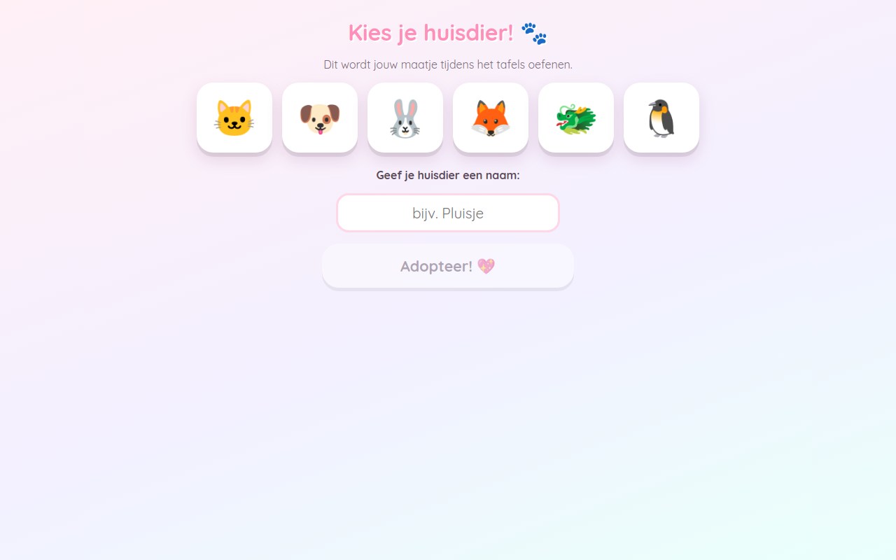
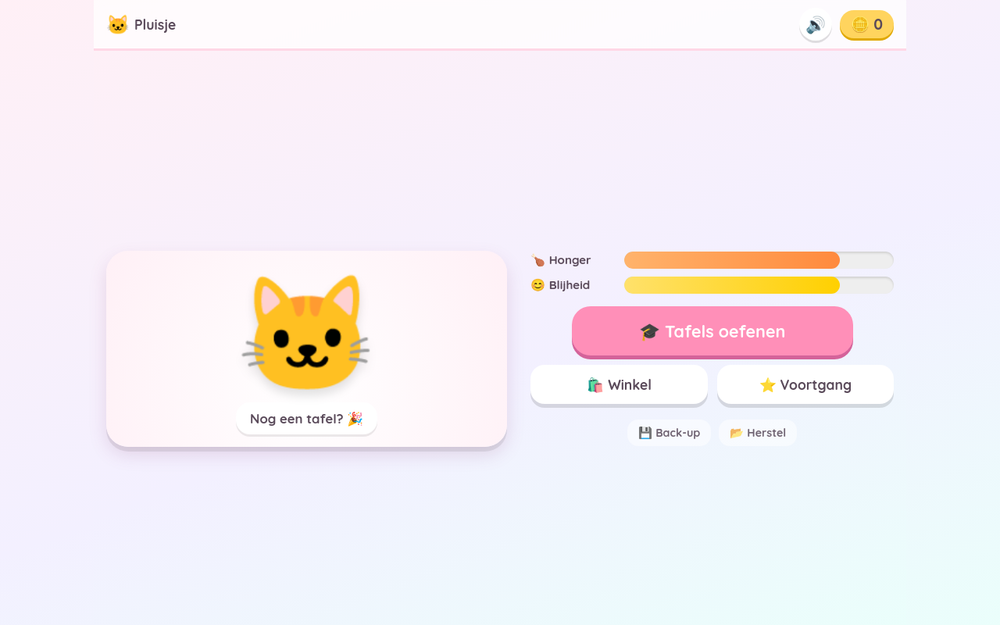
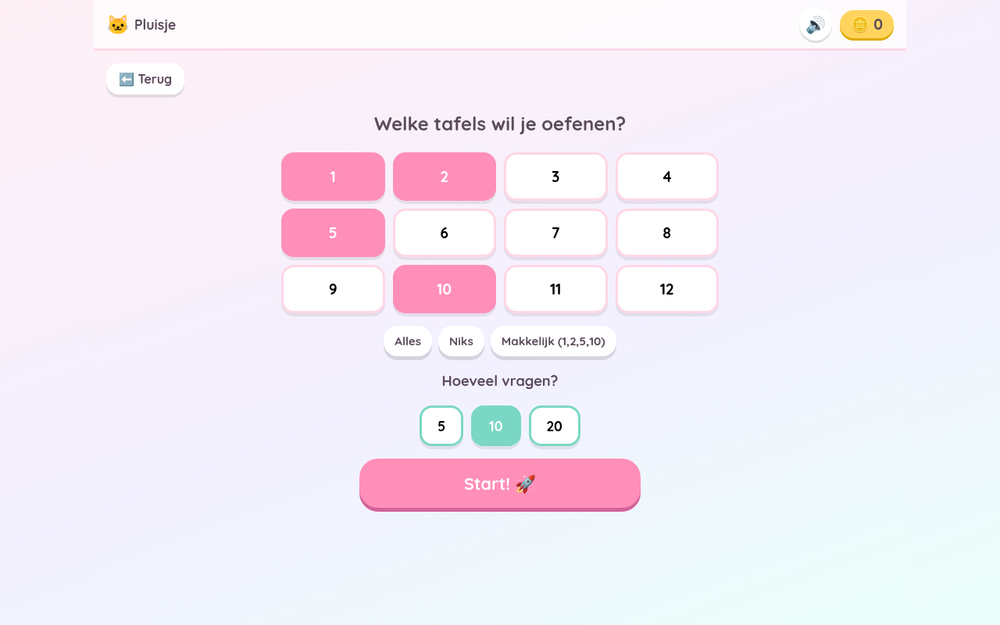
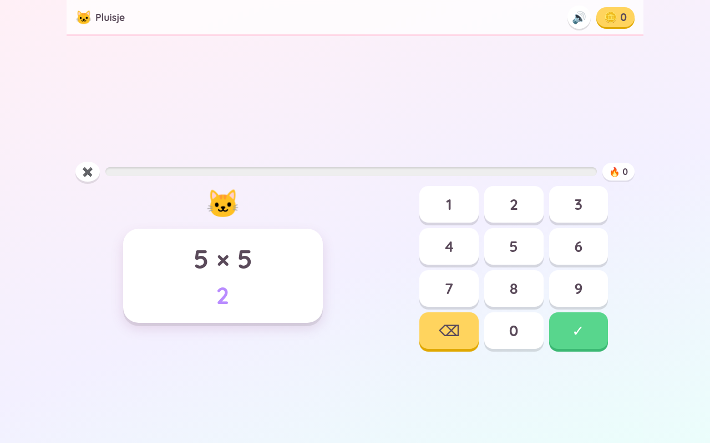
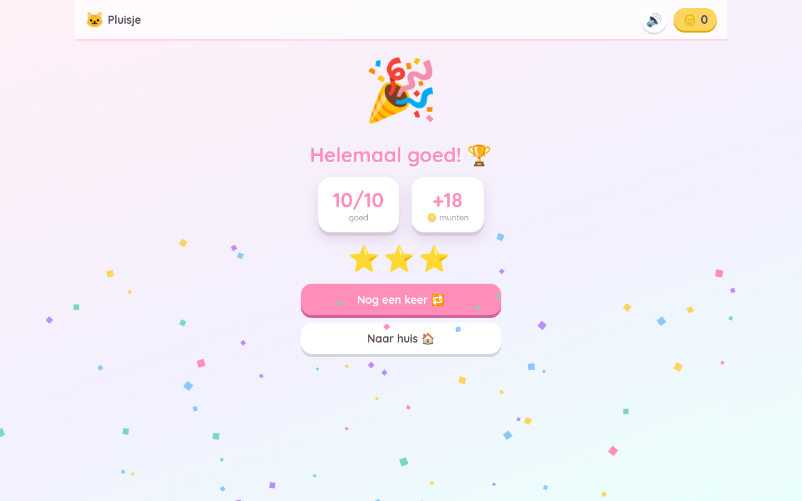
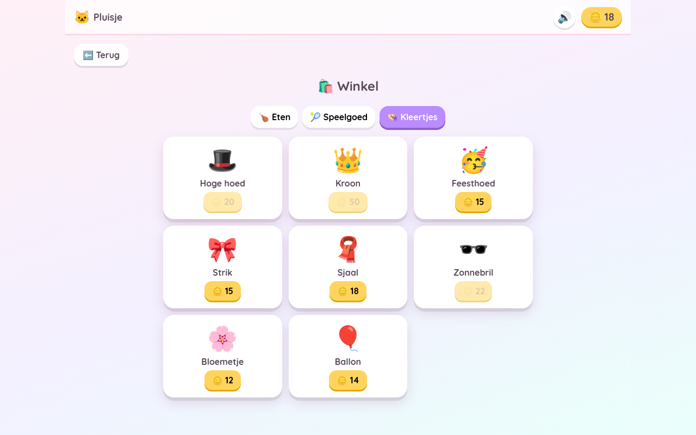

# Tafelpret 🐾

Een **installeerbare app (PWA)** waarmee kinderen (±9 jaar) de **tafels van 1 t/m 12**
leren — van `1 × 1` tot `12 × 12` — met een schattig huisdierthema en gamification:
munten verdienen, je huisdier voeren/verzorgen en leuke kleertjes kopen.

## ▶️ Openen & installeren

**https://aart-janboor.github.io/tafelpret-demo/**

Open die link in **Chrome op de tablet** → "App installeren" (of menu ⋮ →
*Toevoegen aan startscherm*). Je krijgt een eigen app-icoon, de app opent fullscreen
en werkt daarna **offline**. De spelstand blijft lokaal op het toestel bewaard.

## De schermen

| | | |
|---|---|---|
|  |  |  |
| **1. Huisdier kiezen** | **2. Home / verzorgen** | **3. Tafels kiezen** |
|  |  |  |
| **4. Oefenen** | **5. Resultaat** | **6. Winkel** |

## Features

- Tafels 1–12 oefenen; **specifieke tafels** kiezen (bv. alleen de tafel van 2).
- Cijferpad met directe feedback, streak-bonus, confetti en **geluid** (met mute-knop).
- **Munten** verdienen → winkel met eten, speelgoed en kleertjes (zichtbaar op je dier).
- Honger-/blijheidsbalken om je huisdier te verzorgen; **voortgang** per tafel met sterren.
- **Responsive**: twee kolommen op een tablet in liggende stand, één kolom op een telefoon.
- **Offline** (service worker) en **lokale opslag** (IndexedDB + persist) met **back-up/herstel**.

## Techniek

Vanilla HTML/CSS/JS, geen build-stap, geen externe dependencies. Zie
[`PROPOSAL.md`](PROPOSAL.md) voor de volledige opzet en roadmap.

```
index.html · manifest.json · sw.js · icons/ · css/styles.css
js/ → storage.js · sound.js · pet.js · shop.js · quiz.js · app.js
```
